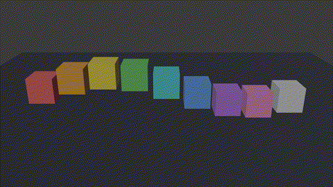

# Blender Python Course — Lesson 1: Cube Wave Animation

**Course:** Blender Python Course — Python Se Blender Expert Bano (PyBlitz)
**Lesson:** 1 of 14 — Beginner level

Nine colorful cubes, rising and falling in a smooth wave — made entirely
with a beginner Python script that runs **inside Blender** (bpy).
No add-ons, no paid tools, just Blender + Python.

## What the script does

1. Clears the scene, so we start empty.
2. Makes **9 cubes in one loop**, each with its own color material.
3. Adds **wave keyframes** (frames 1, 20, 40): every cube follows the same
   sine wave, but starts a little later than the one before it — that
   small delay is what makes the wave travel sideways.
4. Adds a camera and a sun light so the wave can be rendered.
5. Sets the scene to **40 frames at 24 fps** — a short, perfect loop.

## Files

- `wave_animation.py` — the full Lesson 1 script (tested, see below)
- `wave.blend` — the Blender file saved after running the script
- `preview.gif` — the rendered wave loop
- `render/` is NOT included here (40 full-size PNG frames live with the
  video project); the GIF above shows the same loop.

## How to run it

1. Open **Blender** (tested with Blender **4.5.15 LTS**).
2. At the top, switch to the **Scripting** workspace.
3. Click **New** to make a fresh text file, then **Open** and choose
   `wave_animation.py` (or paste the code in).
4. Press **Run Script** (the ▶ play button in the Text Editor header).
5. Switch to the **Layout** workspace and press **Spacebar** (or the
   Play button in the Timeline) to watch the wave loop.
6. To render it yourself: Render → Render Animation (Workbench engine,
   1280×720, frames 1–40).

## Exercises (from the video)

1. **Cubes → spheres:** replace `primitive_cube_add` with
   `primitive_uv_sphere_add` and run again.
2. **Taller or faster wave:** change `WAVE_HEIGHT` for height, or the
   frame numbers `1 / 20 / 40` for speed.

## Next lesson

**Lesson 2: Python se apna pehla 3D object** — make cubes, spheres and
cylinders from code, and set their size, location and rotation.

## Watch

PyBlitz on YouTube: https://youtube.com/@pyblitz
Playlist: Blender Python Course — Python Se Blender Expert Bano
